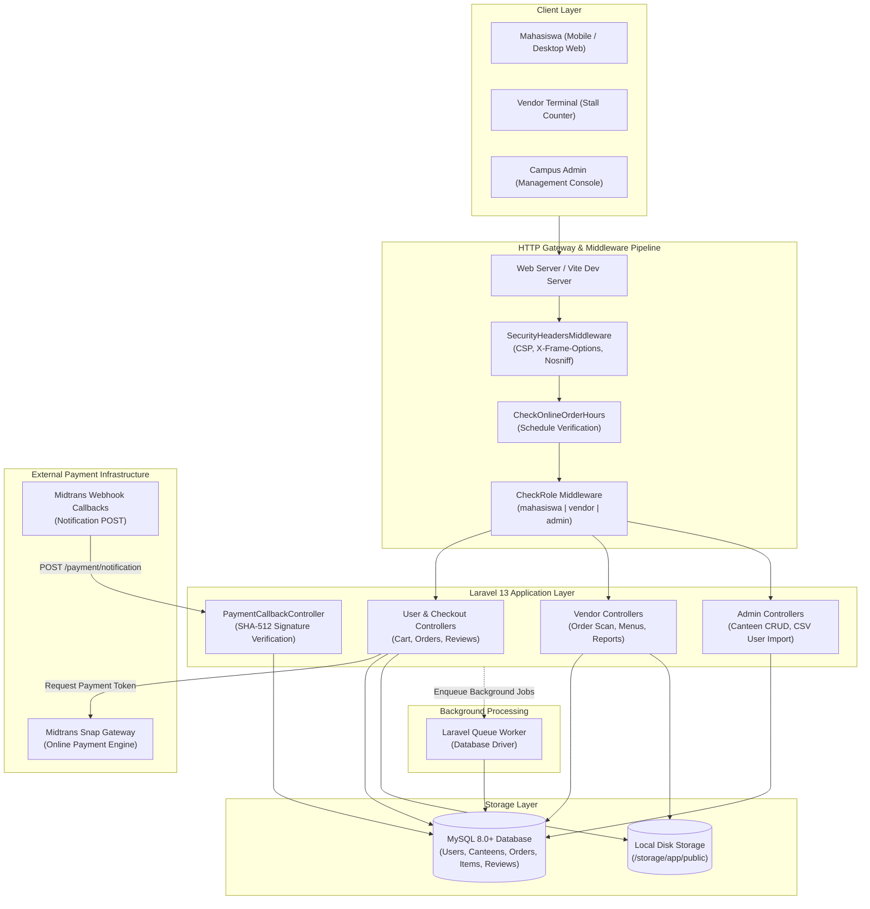

<div align="center">
  

  <p><strong>Campus Canteen Pre-Order and Pickup Platform for Politeknik Negeri Cilacap</strong></p>

  <p>
    <a href="https://laravel.com"></a>
    <a href="https://php.net"></a>
    <a href="https://mysql.com"></a>
    <a href="https://tailwindcss.com"></a>
    <a href="https://daisyui.com"></a>
    <a href="https://alpinejs.dev"></a>
    <a href="https://vitejs.dev"></a>
    <a href="https://midtrans.com"></a>
    <a href="LICENSE"></a>
  </p>
</div>

---

### Quick Start

```bash
git clone https://github.com/pratama1246/PickupOrder-App.git
cd PickupOrder-App
composer run setup
```

---

## Table of Contents

- [System Overview](#system-overview)
- [Practical Use Cases](#practical-use-cases)
- [Core Engineering Capabilities](#core-engineering-capabilities)
- [System Architecture](#system-architecture)
- [Repository Structure](#repository-structure)
- [Environment Configuration](#environment-configuration)
- [Local Setup and Runbook](#local-setup-and-runbook)
- [Midtrans Integration and Webhook](#midtrans-integration-and-webhook)
- [Operational Deployment Runbook](#operational-deployment-runbook)
- [Default Demo Accounts](#default-demo-accounts)
- [Interface Gallery](#interface-gallery)
- [License](#license)

---

## System Overview

**PickupOrder-App** is a multi-role web platform built to solve physical queue congestion across Politeknik Negeri Cilacap (PNC) canteen food stalls during peak break hours. The system enables students to explore canteen menus, submit orders ahead of class dismissal, and choose between automated online payment (Midtrans Snap), manual QRIS transfers with image proof validation, or cash settlement at pickup.

The platform coordinates three distinct user roles:
1. **Student (Mahasiswa)**: Menu discovery, multi-item cart management, checkout with time-fencing validation, order tracking, code-based pickup verification, and menu ratings.
2. **Canteen Vendor**: Food stall profile configuration, live order intake dashboard, barcode/code scanner verification at the counter, menu inventory toggling, daily revenue target monitoring, and sales summaries.
3. **Campus Administrator**: Canteen stall lifecycle management, bulk student account provisioning via spreadsheet/CSV import, access toggles, and system-wide audits.

The application adheres to local-first data residency: all transactions and session states persist in MySQL, static media and payment slips reside on local disk storage with public symlinks, and zero external telemetry is collected.

---

## Practical Use Cases

### 1. Student Peak Lunch Rush (Mahasiswa)
- **Problem**: 15 to 30-minute campus break windows are consumed waiting in line at physical food counters, causing delayed returns to lecture halls.
- **Solution**: Students order meals 10 to 20 minutes prior to break from their phone or laptop. The system holds the order in state until the kitchen prepares it, sending a status update when the food is ready for counter pickup.

### 2. Canteen Stall Kitchen Operations (Vendor)
- **Problem**: Stall operators manage orders via paper notes and unverified phone chat screenshots, resulting in incorrect meals, unpaid orders, and counter chaos.
- **Solution**: The vendor portal surfaces a structured incoming order board. When a student arrives, the vendor enters or scans the order pickup code, marks the item fulfilled, and checks daily gross revenue progress against predefined financial targets.

### 3. Departmental Campus Administration (Admin)
- **Problem**: Academic terms require provisioning hundreds of student accounts and regulating authorized vendors without manual database queries.
- **Solution**: Department administrators use bulk CSV template imports with automatic initial credential configuration (`is_first_login` flag) and manage vendor stall allocations through a single console.

---

## Core Engineering Capabilities

- **Operational Window Enforcement (`CheckOnlineOrderHours` Middleware)**:
  Order placement is strictly bounded to campus operating hours defined in `.env` (`ORDER_START_TIME` to `ORDER_END_TIME`, with active day filtering). Requests outside this window are intercepted at the HTTP pipeline level and rejected with contextual feedback.
- **Dual Payment Verification Flow**:
  - *Automated Webhook*: Incoming Midtrans notifications (`POST /payment/notification`) undergo cryptographic SHA-512 signature validation (`hash('sha512', order_id + status_code + gross_amount + server_key)`) without external SDK roundtrip overhead. Grouped order records tied to a single payment code are transitioned atomically.
  - *Manual QRIS*: Image proofs submitted by students are validated via Intervention Image, stored in private disk directories, and gated behind vendor review before order preparation begins.
- **Non-Blocking Client Status Polling (`/api/order/{id}/payment-status`)**:
  A lightweight JSON polling endpoint allows client interfaces to reflect settlement status in real time if webhook delivery is delayed by network partitions.
- **Unified Cart Synchronization (`SyncCartSession` Middleware)**:
  Cart contents are reconciled between guest session storage and authenticated database records, preventing item loss during login transitions.
- **First-Login Credential Rotation Gate**:
  Accounts seeded or imported by administrators require an immediate password change on first authentication before accessing transactional endpoints.
- **Layered HTTP Defense (`SecurityHeadersMiddleware`)**:
  Applies Content Security Policy (CSP), clickjacking prevention (`X-Frame-Options: SAMEORIGIN`), MIME-type sniffing defense (`X-Content-Type-Options: nosniff`), and rate throttling on login (`5 req/min`) and checkout (`10 req/min`).
- **Tailored Design System Tokens**:
  Utilizes Tailwind CSS v4 `@theme` tokens (`fern-700`, `vanilla-custard-50`, `pnc-navy`) combined with DaisyUI v5 components and Poppins typography.

---

## System Architecture



---

## Repository Structure

```text
pickuporder-app/
├── app/
│   ├── Helpers/
│   │   └── OrderHelper.php              # Schedule validation and active day calculation
│   ├── Http/
│   │   ├── Controllers/
│   │   │   ├── Admin/                   # Canteen CRUD, user bulk operations and CSV imports
│   │   │   ├── AuthController.php       # Authentication, throttling and first-login password flow
│   │   │   ├── HomeController.php       # Public landing and information pages
│   │   │   ├── ProfileController.php    # User and vendor profile and credential updates
│   │   │   ├── User/                    # Cart, Checkout, Order History, Payment Callback, Reviews
│   │   │   └── Vendor/                  # Dashboard, live order processing, menu management, reports
│   │   └── Middleware/
│   │       ├── CheckOnlineOrderHours.php# Restricts checkout to configured operating schedule
│   │       ├── CheckRole.php            # Role-based access control (mahasiswa, vendor, admin)
│   │       ├── SecurityHeadersMiddleware.php # CSP, frame isolation and security headers
│   │       └── SyncCartSession.php      # Session-to-database cart synchronization
│   └── Models/                          # Eloquent entities (User, Canteen, Menu, Order, OrderItem, Review)
├── bootstrap/
│   └── app.php                          # Pipeline configuration, route bindings and CSRF exemptions
├── config/                              # Configuration profiles (services, app, database)
├── database/
│   ├── migrations/                      # Schema migrations (relational tables, QRIS proofs, daily targets)
│   └── seeders/                         # DatabaseSeeder with demo users, canteens and orders
├── docs/                                # Layout analyses and UI design specifications
├── public/
│   ├── assets/                          # Brand SVGs, vector assets and PNC illustrations
│   └── index.php                        # HTTP front controller
├── resources/
│   ├── css/
│   │   └── app.css                      # Tailwind CSS v4 custom theme and color tokens
│   ├── js/
│   │   └── app.js                       # Alpine.js, ApexCharts and Axios client scripts
│   └── views/
│       ├── admin/                       # Campus administrator interface views
│       ├── components/                  # Reusable Blade components (cards, navbar, status badges)
│       ├── layouts/                     # Master templates (app, auth, admin)
│       ├── user/                        # Student-facing views (browse, canteen, checkout, history)
│       └── vendor/                      # Vendor booth portal views (dashboard, scan, menu CRUD)
├── routes/
│   ├── console.php                      # Artisan command definitions
│   └── web.php                          # HTTP routing, middleware groups and webhook entry points
├── tests/                               # Unit and feature test suites
├── composer.json                        # PHP dependencies and automated workflow scripts
├── package.json                         # Node dependencies (Tailwind v4, DaisyUI v5, Alpine)
└── vite.config.js                       # Vite asset build and bundling configuration
```

---

## Environment Configuration

Copy `.env.example` to `.env` and configure key parameters:

| Variable | Default Value | Description |
|---|---|---|
| `APP_NAME` | `PickupOrder-App` | Platform identity title |
| `APP_ENV` | `local` | Environment mode (`local`, `production`) |
| `APP_KEY` | *(Generated)* | 32-character application encryption key |
| `APP_URL` | `http://localhost:8000` | Base URL (must match Ngrok / production domain) |
| `DB_CONNECTION` | `mysql` | Primary database driver |
| `DB_HOST` | `127.0.0.1` | MySQL server host |
| `DB_PORT` | `3306` | MySQL port |
| `DB_DATABASE` | `pickuporder_app` | MySQL database name |
| `DB_USERNAME` | `root` | Database username |
| `DB_PASSWORD` | `""` | Database password |
| `ORDER_START_TIME` | `07:30` | Daily operational opening time (WIB) |
| `ORDER_END_TIME` | `15:30` | Daily operational cutoff time (WIB) |
| `ORDER_ACTIVE_DAYS` | `Monday,Tuesday,...` | Comma-delimited active order days |
| `MIDTRANS_SERVER_KEY` | *(Required)* | Midtrans server authentication key |
| `MIDTRANS_CLIENT_KEY` | *(Required)* | Midtrans client public key |
| `MIDTRANS_IS_PRODUCTION` | `false` | Set `true` for live production transactions |
| `QUEUE_CONNECTION` | `database` | Asynchronous queue driver |
| `SESSION_DRIVER` | `database` | Session persistence storage |

---

## Local Setup and Runbook

### Prerequisites

| Component | Minimum Version | Note |
|---|---|---|
| PHP | `^8.3` | Required extensions: `pdo_mysql`, `curl`, `mbstring`, `gd` |
| Composer | `^2.5` | Dependency management |
| Node.js | `^20.0` | Node Package Manager (`npm`) |
| MySQL | `^8.0` | Or MariaDB `^10.5` |

### 1. Automated Setup (Recommended)

Run the predefined setup script which handles dependency installation, `.env` initialization, key generation, database migration, and frontend asset compilation:

```bash
composer run setup
```

After the script finishes, generate the public storage symlink for uploaded canteen images and QRIS receipts:

```bash
php artisan storage:link
```

*(Optional)* Seed demo data (users, canteens, menus, and historical orders):

```bash
php artisan db:seed
```

### 2. Manual Step-by-Step Setup

If configuring step-by-step:

```bash
# Clone and enter workspace
git clone https://github.com/pratama1246/PickupOrder-App.git
cd PickupOrder-App

# Install backend dependencies
composer install

# Environment initialization
cp .env.example .env
php artisan key:generate

# Execute database migrations
php artisan migrate

# Link public storage disk
php artisan storage:link

# Install and build frontend assets
npm install
npm run build
```

### 3. Running the Development Stack

To run all development processes concurrently (Laravel server, queue listener, log streaming via Pail, Vite asset watcher, and Ngrok tunnel):

```bash
composer run dev
```

Alternatively, run each process in dedicated terminal tabs:

```bash
# Terminal 1: HTTP Server
php artisan serve --host=0.0.0.0 --port=8000

# Terminal 2: Queue Listener
php artisan queue:listen --tries=1

# Terminal 3: Asset Compiler
npm run dev
```

---

## Midtrans Integration and Webhook

The platform supports three checkout methods:
- **Midtrans Snap**: Credit Card, GoPay, ShopeePay, Bank Transfer (BCA, BNI, BRI, Mandiri). Handled via client popup and verified through backend webhook callbacks.
- **Manual QRIS**: The student transfers via standard static/dynamic QRIS, uploads the screenshot receipt, and awaits vendor counter confirmation.
- **Pay Direct**: Cash on pickup confirmed manually at the canteen register.

### Webhook Handling (`POST /payment/notification`)

- This route is excluded from CSRF validation inside `bootstrap/app.php` to accept external calls from Midtrans servers.
- The controller calculates the expected SHA-512 signature using the raw payload and `MIDTRANS_SERVER_KEY`:
  ```php
  $expected = hash('sha512', $orderId . $statusCode . $grossAmount . $serverKey);
  ```
  If signatures match, order statuses (`pending`, `settlement`, `expire`, `cancel`) are propagated to all items associated with the `payment_code`.

### Local Webhook Testing via Ngrok

1. Start an Ngrok tunnel pointing to port 8000:
   ```bash
   ngrok http 8000
   ```
2. Note the generated HTTPS forwarding URL (e.g. `https://your-domain.ngrok-free.app`).
3. Set your notification endpoint in the [Midtrans Sandbox Dashboard](https://dashboard.sandbox.midtrans.com):
   `Settings > Configuration > Payment Notification URL`
   ```
   https://your-domain.ngrok-free.app/payment/notification
   ```
4. Update `APP_URL` in `.env`:
   ```env
   APP_URL=https://your-domain.ngrok-free.app
   ```

---

## Operational Deployment Runbook

When deploying to a production server (Ubuntu/Debian, Nginx, PHP-FPM, MySQL):

### 1. Production Build & Optimization
```bash
composer install --no-dev --optimize-autoloader
npm ci && npm run build

php artisan config:cache
php artisan route:cache
php artisan view:cache
php artisan storage:link
php artisan migrate --force
```

### 2. Supervisor Configuration for Queue Workers
Create `/etc/supervisor/conf.d/pickuporder-worker.conf`:

```ini
[program:pickuporder-worker]
process_name=%(program_name)s_%(process_num)02d
command=php /var/www/pickuporder-app/artisan queue:work database --sleep=3 --tries=3 --max-time=3600
autostart=true
autorestart=true
stopasgroup=true
killasgroup=true
user=www-data
numprocs=2
redirect_stderr=true
stdout_logfile=/var/www/pickuporder-app/storage/logs/worker.log
stopwaitsecs=3600
```

Update supervisor processes:
```bash
sudo supervisorctl reread
sudo supervisorctl update
sudo supervisorctl start pickuporder-worker:*
```

### 3. Automated Test Execution
Run test verification suites prior to shipping updates:

```bash
composer run test
```

---

## Default Demo Accounts

Initial data populated by `php artisan db:seed`:

> Default password for all seeded accounts: `pncpickup123`

| Role | Username / Identifier | Email Address | Initial State |
|---|---|---|---|
| **Admin** | `admin` | `admin@pnc.ac.id` | Active |
| **Vendor 1 (Kantin Harmoni)** | `vendor_harmoni` | `kantinharmoni@pnc.ac.id` | Active (Booth Open) |
| **Vendor 2 (Kantin MI)** | `vendor_mi` | `miacademy@pnc.ac.id` | Active (Booth Open) |
| **Student (Mahasiswa)** | `demo_student` | `demo.student@pnc.ac.id` | Requires password change on first login |

---

## Interface Gallery

### Customer Discovery & Mobile Layout
<p align="center">
  
</p>

<p align="center">
  
</p>

### Menu Catalog & Detail View
<p align="center">
  
</p>

<p align="center">
  
</p>

### Operational Portals
<p align="center">
  
</p>

<p align="center">
  
</p>

---

## License

This software is open-source, distributed under the [MIT License](LICENSE). Politeknik Negeri Cilacap.
